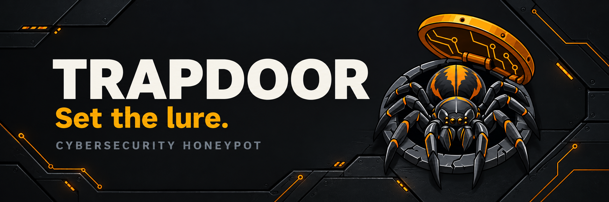

# TRAPDOOR 🕷️

An internal honeypot lab for teaching **CompTIA Network+** and **Security+**.

A trapdoor spider doesn't advertise. It builds a door that looks like nothing,
waits behind it, and the interesting part is the ambush. Same idea here: the
services look ordinary, and everything that touches them is recorded.

## What this is

A Docker Compose stack of low-cost honeypots with a **single normalized event
schema** across all of them, plus a library of **scripted attacks** so a session
is reproducible in class.

Built for a classroom, not for internet-scale threat collection.

## What this is NOT

- Not a threat-intel feed. It runs on an internal network and only sees traffic
  you point at it.
- Not a production security control. Do not put this on a network segment that
  also carries real production traffic without a reviewed firewall policy.
- Not a fork of Cowrie or any other honeypot. We run upstream images and own the
  parts that are actually ours: the schema, the pipeline, the scenarios, the labs.

## Why internal-only is the right call for a lab

| | Public honeypot | Internal lab honeypot |
|---|---|---|
| Background noise | Thousands of bot sessions/day, free | None — you generate it |
| Reproducible? | No. You can't replay today's traffic tomorrow | **Yes — same scenario, same session** |
| Legal / privacy | Real third-party creds and payloads | Only your own lab traffic |
| Teaching fit | "Look at this map" | **"Watch this attack, then find it in the logs"** |

The honest tradeoff: the dashboard will be empty until an instructor runs a
scenario. That is by design, not a bug. The lab is a **replay and observation
environment**.

## Stack

| Component | Role |
|---|---|
| **Cowrie** | SSH + Telnet honeypot, emulated shell, captures uploads |
| **nginx** | Web decoy — real server, real logs, scanner bait paths |
| **Shipper** | Normalizes both sources into one JSONL schema — **required**; `make logs` follows it and nothing is normalized without it |
| *(optional)* | OpenSearch + Dashboards via `compose.siem.yml` |

Default footprint: ~2–4 GB RAM, and **plan on disk** — the core stack writes
`out/events.jsonl` continuously and retention (default 14 days, `RETENTION_DAYS`)
only deletes whole files older than the cutoff, so a file that is still being
written is never pruned. A busy lab produces hundreds of MB a day; budget a few
GB of free space before a class, and check `.verify/` and `out/` on a laptop that
has been running for a month. The observability stack is opt-in so a laptop or a
small LXC can run the core.

## The event schema

Every honeypot speaks its own dialect. TRAPDOOR's job is to flatten them into
one shape so a student can reason about "an event" regardless of protocol.

See [`schema/event.schema.json`](schema/event.schema.json) — that file is the
contract; if this page and the schema ever disagree, the schema wins and this
page is a bug.

```json
{
  "ts": "2026-11-01T22:04:11.512Z",
  "sensor": "cowrie",
  "event": "auth_failed",
  "proto": "ssh",
  "src_ip": "10.20.30.44",
  "src_port": 51233,
  "dst_port": 2222,
  "session_id": "a1b2c3",
  "username": "root",
  "password": "toor",
  "payload_sha256": null,
  "scenario_id": "simnet-1"
}
```

| Field | Meaning |
|---|---|
| `ts` | UTC, ISO 8601, milliseconds |
| `sensor` | `cowrie` \| `nginx` — which honeypot produced it |
| `event` | `connect` \| `disconnect` \| `auth_failed` \| `auth_success` \| `command` \| `upload` \| `download` \| `http_request` |
| `proto` | `ssh` \| `telnet` \| `http` |
| `src_ip` / `src_port` | Who knocked |
| `session_id` | Ties events into one attacker transcript |
| `username` / `password` | Only when the protocol carries creds |
| `payload_sha256` / `payload_bytes` | Hash and size of a transferred artifact. **The bytes themselves are not in this log** — see below. |
| `scenario_id` | Set by scripted attacks so class sessions are filterable |

## Quick start

```bash
git clone https://github.com/crperdue73/Trapdoor.git && cd trapdoor
cp .env.example .env          # set SENSOR_NAME, LAB_CIDR
make up                        # core stack: cowrie + nginx + shipper
make logs                      # follow normalized JSONL
make up-siem                   # optional: add OpenSearch + dashboards
```

Then:

```bash
make scenario SCENARIO=ssh-bruteforce   # scripted attack, tagged with a scenario id
make sessions                         # list sessions with event counts
make sessions SESSION=a1b2c3          # render one session as a transcript
```

### What the transcript looks like

Real output of `make sessions SESSION=a1b2c3` against one brute-force run.
Ten events, one attacker, one page:

```
ts                       event          proto detail
2026-11-01T22:04:09.117Z connect        ssh
2026-11-01T22:04:10.882Z auth_failed    ssh   admin:admin
2026-11-01T22:04:11.512Z auth_failed    ssh   root:toor
2026-11-01T22:04:12.006Z auth_success   ssh   root:toor
2026-11-01T22:04:13.440Z command        ssh   id
2026-11-01T22:04:19.004Z command        ssh   uname -a
2026-11-01T22:04:24.771Z command        ssh   cat /etc/passwd
2026-11-01T22:04:31.095Z command        ssh   ls -la /
2026-11-01T22:04:37.612Z command        ssh   echo "TRAPDOOR-CANARY"
2026-11-01T22:04:39.020Z disconnect     ssh
```

That is the lesson in ten lines: two rejected guesses, one accepted, then the
five commands everyone types first — all of it from an emulated shell where
nothing ran.

## Safety rails (and why they exist)

These are teaching material, not just hygiene:

- **No execution path from a captured payload.** The shipper records a hash
  and a byte count; the payload bytes themselves never enter the event log.
  Cowrie's own container volume (`cowrie_var`, mounted read-only into the
  shipper at `/in/cowrie`) *does* retain what was uploaded, inside the
  honeypot container's storage — it is inert, nothing runs it, and `make clean`
  removes it with the volume. If you want a shorter tail, set
  `RETENTION_DAYS` and prune that volume between classes.
- **Egress is locked down** on the honeypot containers. A compromised honeypot
  must not become a pivot.
- **Retention is short and explicit.** Honeypot data grows fast and is mostly
  worthless noise. The default is 14 days (`RETENTION_DAYS`); pruning only
  deletes whole files past the cutoff, so the file currently being written
  survives regardless of age. Budget disk accordingly — see the footprint note
  above.
- **Scoped to `LAB_CIDR`.** The firewall rules generated by `make firewall` only
  allow traffic from the lab subnet.

## Layout

```
compose.yml
compose.siem.yml
cowrie/         Cowrie config + lab filesystem
web/            nginx decoy: config + html
schema/         event.schema.json — the contract
shipper/        normalizer: honeypot dialects -> one schema
scenarios/      scripted attacks
docs/           setup, labs, retention
```

## License

MIT. See [LICENSE](LICENSE).
